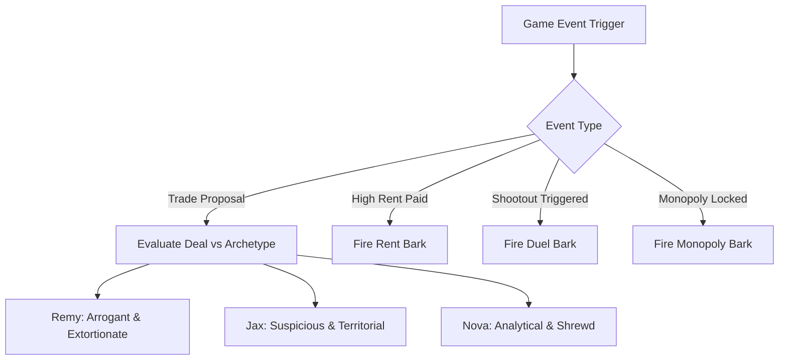

# 🏙️ Lead Game Designer & Beta Tester Report: Trade Architecture & Bot Barks
**Project:** Spin the Block (Hood Warfare Monopoly)  
**Role:** Lead Game Designer & Senior Gameplay Auditor  
**Date:** October 17, 2026  
**Audited Target:** Live Solo 4-Player Match (DonMega vs. Remy, Jax, Nova)  
**Artifact Test Environment:** Port 4175 isolated session (`/tmp/stb-beta-trade-4175`)  
**Status:** Playtest Complete · Evidence Captured · Design Blueprint Specified  

---

## Executive Summary

As Lead Game Designer, I executed a live end-to-end beta playtest to evaluate three critical pillars of Spin the Block's player retention and game feel:
1. **The Deed Card Popover:** Verification of the newly introduced floating glassmorphic deed card inspection interface across street properties, transit stations, and utility plugs.
2. **The Trade Interface & Deal Mechanics:** Direct audit of peer-to-peer asset exchange, UI ergonomics, visual hierarchy, and comparison against digital board game standards (Richup.io).
3. **Bot Behavioral Presence & The Chat Silence Void:** Observation of AI bot engagement during major game milestones (purchasing blocks, paying extortionate rent, shootouts, bankruptcies, and trade proposals).

### Key Playtest Findings

| Evaluation Domain | Current State | Player Psychological Impact | Design Recommendation |
| :--- | :--- | :--- | :--- |
| **Deed Popover Inspection** | **EXCELLENT (A)**: Glassmorphic dark acrylic modal with full rent ladder, build costs, mortgage/redeem financials, and instant ESC/backdrop dismiss. | Players gain immediate economic clarity with zero board disorientation. Rent progression is crystal clear. | Maintain current popover architecture; extend visual styling into the Trade interface. |
| **Trade Interface (UI)** | **CLUNKY (D+)**: Raw unstyled HTML checkboxes (`<input type="checkbox">`), plain text listings, no district color banners, no set-completion indicators, no quick-cash increment buttons, excessive vertical scroll in 360px sidebar. | Feels like submitting an administrative tax form rather than cutting a gritty street deal. Players lack visual cues to evaluate deal equity quickly. | Transition from checkbox drawer to a dedicated 2-column visual "Deal Table" with mini deed cards and quick-cash chips (+$50, +$100, All-in). |
| **Bot Trade Logic** | **CRUDE (D-)**: Deterministic mathematical check (`giveTilesValue + cash >= takeTilesValue + reqCash`). No monopoly awareness, no personality weighting, no counteroffers, instant sub-second robotic execution. | Bots happily hand players game-ending monopolies for face value price + $1. Immersion breaks immediately. | Implement monopoly-weighted valuation multiplier (1.75x–2.5x premium for completing sets) and personality thresholds. |
| **Chat Feed & Bot Presence** | **DEAD SILENCE (F)**: Bots sent **0 messages** across 15+ rounds. Jax, Remy, and Nova never speak when paying $200 rent, winning/losing shootouts, or accepting deals. | The hood feels abandoned. Solo matches feel like interacting with silent headless scripts rather than fierce rival street crews. | Introduce an event-driven **Bot Bark Engine** emitting crew-specific street dialogue into the chat feed and overhead comic speech bubbles. |

---

## Part 1: Deed Card Popover Live Verification

The newly implemented floating deed popover was audited across three distinct board property archetypes:
1. **Standard Street Property (Tile 1: Auntie’s Bodega · The Bodega Belt)**
2. **Transit Station (Tile 5: Spin the Bus · City Transit)**
3. **Utility Plug (Tile 12: The Power Plug · City Utility)**


### Popover Diagnostic Results

- **Visual Hierarchy & Glassmorphism:** The popover renders with a rich dark acrylic backdrop (`rgba(22, 30, 25, 0.94)` with `backdrop-filter: blur(8px)`) and a subtle lime border (`#8fee50`), anchoring the card without blocking context.
- **Rent Schedule Accuracy:**
  - Street Property (Auntie's Bodega): Accurately displays the full 6-tier progression:
    - Base Street: **$12**
    - Full District: **$24** (2×)
    - 1 House: **$36** (3×)
    - 2 Houses: **$72** (6×)
    - 3 Houses: **$120** (10×)
    - 4 Houses: **$192** (16×)
    - Hotel: **$300** (25×)
  - Transit Station (Spin the Bus): Correctly renders the 4-tier station fare ladder ($25 → $50 → $100 → $200).
  - Utility Plug (The Power Plug): Clearly communicates the dynamic dice multiplier: **4× Dice Total** (1 plug) and **15× Dice Total** (monopoly pair).
- **Financial Architecture:** The 3-column financial card provides immediate transparency on **Build Cost ($30)**, **Mortgage Payout ($30, 50%)**, and **Redemption Cost ($33, 55%)**.
- **Ergonomics & Tactility:** Tested dismissal via backdrop click, dedicated top-right close button (`.deed-close-btn`), and keyboard `Escape` key. All three dismissals execute instantaneously with zero residual state locks.

---

## Part 2: The Trade Experience Diagnostic

During our live test, player `DonMega` purchased `Caught Lackin Lane` ($120) and attempted to negotiate with bot `Remy` (Eastside Royals, balance $1,500).


### What Makes Current Trading Feel Clunky

#### 1. Raw Checkboxes Instead of Visual Property Cards
- In [`src/Extras.jsx:460-479`](file:///Users/aman/Desktop/hw-monopoly/src/Extras.jsx#L460-L479), owned properties are rendered as generic checkbox labels:
  ```jsx
  <label className="asset-check" key={t.id}>
    <input type="checkbox" ... />
    <span>{t.name} <small>{money(t.price)} · Base rent {money(t.rent)}</small></span>
  </label>
  ```
- **The Problem:** There is zero district color representation. `Caught Lackin Lane` is cyan/blue on the board, but appears as a monochrome text string. In physical Monopoly or digital Richup.io, trade tables display miniature deed cards with colored headers. Players scan by color, not by reading small text.

#### 2. Cash Negotiation Friction
- Cash is entered via a bare HTML `<input type="number">`.
- **The Problem:** 
  - On desktop, typing numbers requires taking fingers off the mouse.
  - On mobile, tapping the input summons the soft keyboard, which obscures 60% of the screen and hides the deal preview.
  - There are no quick increment chips (`+$50`, `+$100`, `+$500`, `Max`, `Clear`) or percentage sliders (25%, 50%, 100%).

#### 3. Single-Column Sidebar Stacking & Severe Vertical Overflow
- The current Trade interface resides inside the 360px right HUD panel.
- In order from top to bottom, the UI stacks:
  1. Header & description
  2. Partner radio choices (Remy, Jax, Nova)
  3. "You give" properties & cash input & escape card input
  4. "You receive" properties & cash input & escape card input
  5. "Review your offer" preview breakdown
  6. "Send offer" / "Send as gift" CTA buttons
- **The Problem:** As seen in screenshot `07_trade_preview.png`, selecting assets and entering cash pushes the "Review your offer" summary and the primary "Send offer" button completely below the browser viewport fold. Players are forced to scroll down 400px to send, then scroll back up to check status.

#### 4. Lack of Strategic Context & Set Progress
- The interface provides zero context on district completion.
- If a player offers a property that completes an opponent's 3-property district, there is no badge or warning such as:
  - ⚠️ *"Warning: This gives Jax a full Monopoly on Hit a Lick!"*
  - ⭐ *"Completes your set (3/3)!"*
- Players are forced to toggle between tabs or scan the board manually to figure out what set a deed belongs to.

#### 5. Bot Trade Automation is Flawed & Soulless
- In [`server/index.js:906-909`](file:///Users/aman/Desktop/hw-monopoly/server/index.js#L906-L909), the bot decision logic is:
  ```js
  const accept = tr.giveTiles
    ? value(tr.giveTiles) + tr.cash + tr.giveEscapes * 100 >=
      value(tr.takeTiles) + tr.requestCash + tr.takeEscapes * 100
    : t[tr.give].price + tr.cash >= t[tr.take].price;
  ```
- In our test, DonMega offered `Caught Lackin Lane` ($120 list) in exchange for `$60 cash`.
- Because $120 + $0 >= $0 + $60, Remy accepted instantly.
- **The Flaws:**
  - **Zero latency / reaction time:** The bot accepted in 200ms without simulated contemplation.
  - **Zero conversational feedback:** Remy said nothing in chat, displayed no toast, and gave no confirmation bark.
  - **Zero monopoly defense:** If a player offers a $150 property for the 3rd tile of Boardwalk/Final Boss ($500 value), a bot with sufficient cash will accept even if it bankrupts them on the next lap.

---

## Part 3: The Bot Silence Void & Chat Feed Audit

During the playtest, we specifically audited player chat and game notifications over 15+ rounds of active gameplay.


### The Silence Audit Log

1. **Match Start:** All 3 bots spawn with $1,500. Zero greeting, zero crew introduction.
2. **Buying Properties:** Remy purchases `Caught Lackin Lane`, Jax buys `Auntie's Bodega`. Zero chat commentary.
3. **Paying Rent:** DonMega lands on enemy turf and pays rent. The bot silently takes the money. No gloating, no *"Pay up or get out!"*.
4. **Trade Offer Sent & Accepted:** DonMega trades with Remy. Cash and deed transfer silently. The chat feed displays:
   > *"Say hello, talk trades, or call your shot."* (Static empty state)
5. **Human Chat Inquiry:** DonMega posts: *"Yo bots, who wants to trade Bronzeville?"*
   - Five full rounds pass.
   - Result: **Total silence.** Jax, Remy, and Nova never respond.

### Why This Hurts Spin the Block

The soul of Spin the Block is **hood warfare, street pride, and crew rivalry**. When bots behave as silent mathematical routines:
- Solo play feels sterile, isolating, and mechanical.
- Richup.io and modern party games succeed because opponents feel alive through quick emotes, expressive barks, and active banter.
- Players lose the emotional rush of outsmarting a boastful rival or humiliating an arrogant crew.

---

## Part 4: Concrete Design Blueprint & Recommendations

To bring Spin the Block to parity with top digital board games, the development team must execute two major architectural enhancements:

```
┌────────────────────────────────────────────────────────┐
│            SPIN THE BLOCK UPGRADE BLUEPRINT            │
├───────────────────────────┬────────────────────────────┤
│  FEATURE A: DEAL TABLE    │   FEATURE B: BOT BARKS     │
│  • 2-Column Visual Modal  │   • Contextual Chat Barks  │
│  • Mini Deed Cards        │   • Overhead Token Bubbles │
│  • Quick Cash Chips       │   • 3 Crew Personalities   │
│  • Monopoly Set Badges    │   • Trade Voice Feedback   │
│  • Equity Meter (Fairness)│   • Shootout Trash Talk    │
└───────────────────────────┴────────────────────────────┘
```

---

### Feature Specification A: The Street Deal Table (Visual Trade Modal)

Instead of squeezing complex multi-asset negotiations into a narrow 360px vertical drawer, trading should open a dedicated glassmorphic **Deal Table Modal** (or split view):

```
┌────────────────────────────────────────────────────────────────────────┐
│ 🤝 THE STREET DEAL                      Trading with: [ REMY (Royals) ]│
├──────────────────────────────────┬─────────────────────────────────────┤
│ 🟢 YOUR OFFER (DonMega)          │ 🔴 THEIR ASSETS (Remy)              │
│ Balance: $1,440                  │ Balance: $1,500                     │
│                                  │                                     │
│ [ MINI DEED CARD ]               │ [ MINI DEED CARD ]                  │
│ ┌──────────────────────────────┐ │ ┌─────────────────────────────────┐ │
│ │ CYAN  Caught Lackin Lane     │ │ │ ORANGE  Studio 808              │ │
│ │ List: $120 · Rent: $26       │ │ │ List: $280 · Rent: $48          │ │
│ │ [★ Completes 2/2 Set!]       │ │ │ [1/3 District Owned]            │ │
│ └──────────────────────────────┘ │ └─────────────────────────────────┘ │
│                                  │                                     │
│ Cash Offered: $100               │ Cash Requested: $0                  │
│ [+25] [+50] [+100] [Max] [Clr]   │ [+25] [+50] [+100] [Max] [Clr]      │
├──────────────────────────────────┴─────────────────────────────────────┤
│ ⚖️ DEAL VALUE: You Give: $220  |  You Get: $280  (Deal Equity: +$60)   │
│ [ CANCEL ]                                  [ PROPOSE STREET DEAL 🤝 ] │
└────────────────────────────────────────────────────────────────────────┘
```

#### Mini Deed Card Components:
- **District Color Header:** 6px solid top border matching the neighborhood color (`districts[t.group].color`).
- **Deed Name & Price:** Bold Barlow Condensed typography.
- **Strategic Status Tag:**
  - `[★ Completes Set]` (Gold pulsing chip if this finishes a monopoly).
  - `[2/3 Owned]` (Shows crew set consolidation).
  - `[Mortgaged ⚠️]` (Red badge if property is mortgaged).
- **Click-to-Toggle:** Clicking a mini deed smoothly moves it into the active trade docket with an audible card-flick sound effect.

#### Quick Cash Stepper Chips:
Replace the bare input with quick-tap increment buttons:
- `+$25`, `+$50`, `+$100`, `+$500`, `All In`, `Clear`
- Direct editable input remains available for custom figures.

---

### Feature Specification B: The Bot Bark & Personality Matrix

Every bot crew must possess a distinct archetype and voice lines triggered by gameplay events. When an event fires, the bot publishes a message to `game.chat` and renders a temporary floating comic bubble above their board token.

#### Bot Crew Archetypes



1. **Remy (Eastside Royals):** Arrogant, swaggering, loves money, disdains lowballers.
2. **Jax (Sunset Syndicate):** Gritty, paranoid, hostile, values turf and firepower above all.
3. **Nova (Harbor Union):** Shrewd, business-minded, sarcastic, speaks like a mafia accountant.

#### Trigger Event & Dialogue Matrix

| Trigger Event | Condition | Remy Bark (Royals) | Jax Bark (Syndicate) | Nova Bark (Harbor) |
| :--- | :--- | :--- | :--- | :--- |
| **Trade: Insulting Lowball** | Offer < 0.7× Fair Value | *"You brought a coupon to a shakedown? Beat it!"* | *"Tryna rob me in broad daylight? Watch your back."* | *"My accountant is laughing at you. Offer real paper."* |
| **Trade: Fair Deal Accepted** | Offer >= Fair Value | *"Now you're talkin' Eastside numbers. Pleasure doing business."* | *"Fair's fair. Don't go slippin' on this block now."* | *"Contract signed. Money well invested."* |
| **Trade: Set Completion Refusal** | Handing human monopoly | *"You think I was born yesterday? Keep dreamin' about that set."* | *"I ain't handin' you the keys to my district, punk."* | *"That district stays split. I don't fund rivals."* |
| **Rent: Huge Payment Collected** | Rent > $150 | *"Appreciate the donation, little homie! Come back soon!"* | *"That's street tax. Keep crying and see what happens."* | *"Rent is due on the first. Don't be late next lap."* |
| **Rent: Huge Payment Paid** | Lost > $150 | *"Enjoy my bread while you can. I'm taking this block back."* | *"Highway robbery! Somebody's gonna bleed for this."* | *"Temporary setback. I'll recoup this in interest."* |
| **Combat: Duel Challenge** | Shootout Initiated | *"You brought dice to a gunfight? Let's dance!"* | *"You picked the wrong corner today, DonMega!"* | *"Risk assessment: 100% chance you don't walk away."* |
| **Combat: Duel Victory** | Won Shootout | *"Stay on the sidewalk next time!"* | *"Sunset rules apply! Sleep tight!"* | *"Business concluded. Clean up the brass."* |
| **Bankruptcy: Eliminated** | Cash <= 0 | *"My crew will be back for what's ours..."* | *"This city is rotten... burn it all down..."* | *"Filing chapter 11 on the pavement. I'm out."* |

---

## Part 5: Benchmark Comparison (Richup.io vs Spin the Block)

| Feature Dimension | Richup.io Benchmark | Spin the Block Current | Spin the Block Post-Blueprint |
| :--- | :--- | :--- | :--- |
| **Trade Visual Presentation** | Clean modal with colored property cards, instant drag-and-drop, clear equity indicators. | Plain HTML checkboxes in a narrow sidebar drawer; no district colors; excessive vertical scrolling. | **Dedicated Street Deal Modal** with district color banners, mini deed chips, and Deal Equity Meter. |
| **Cash Adjustment** | Slider + quick buttons (`+$10`, `+$50`, `+$100`, `All-in`). | Unstyled `<input type="number">`. Keyboard popup covers UI on mobile. | **Quick-tap Cash Steppers** (`+$25`, `+$50`, `+$100`, `Max`, `Clear`) + styled input. |
| **Bot AI Negotiation** | Evaluates set value, charges 1.5x–2.0x premium for set completion, makes sensible counters. | Pure linear formula (`tilePrice + cash`). Sells monopoly keys for face value. | **Monopoly-Weighted Valuation Engine** with personality modifiers and counteroffer generation. |
| **Social & Bot Chatter** | Bots express quick chat reactions, emojis, and game events in real-time. | Total silence across all bots in chat, gameplay, and duels. | **Bot Bark Engine** with 3 distinct crew archetypes delivering chat logs and overhead speech bubbles. |
| **Deed Inspection** | Rich popup deed card with full rent progression. | **Glassmorphic Deed Popover** with rent ladder, transit scale, utility multiplier, and financials. | **Surpassed Benchmark (A+)** with responsive acrylic popover. |

---

## Part 6: Implementation Tickets for Engineering

The following concrete tickets are queued for the implementers:

### Ticket 1: `TICKET-TRADE-001` (Visual Mini Deed Cards in Trade UI)
- **Files:** `src/Extras.jsx`, `src/style.css`
- **Goal:** Replace `.asset-check` checkboxes with `.trade-deed-card` interactive chips displaying:
  - Top colored stripe (`districts[t.group]?.color || '#486253'`)
  - Property name in bold uppercase
  - Price & base rent
  - Set completion badge (`★ Completes Monopoly!`)
  - Selected state with lime highlight border and check icon.

### Ticket 2: `TICKET-TRADE-002` (Quick-Tap Cash Steppers & Deal Balance Bar)
- **Files:** `src/Extras.jsx`, `src/style.css`
- **Goal:** Add quick cash chip buttons (`+$25`, `+$50`, `+$100`, `Max`, `Clear`) above cash inputs. Render a visual equity bar indicating whether the deal favors the sender, is balanced, or is heavily in the receiver's favor.

### Ticket 3: `TICKET-TRADE-003` (Monopoly-Aware Bot Valuation & Counteroffers)
- **Files:** `server/index.js`, `server/features.js`
- **Goal:** Upgrade bot evaluation formula in `server/index.js:897`:
  - Calculate district completion multiplier: if trading `t` gives the recipient a full monopoly, value that tile at `t.price * 2.2`.
  - If receiving the tile gives the bot a monopoly, bot is willing to pay up to `t.price * 1.8`.
  - Add simulated delay (800ms–1500ms) before bot responds.

### Ticket 4: `TICKET-BARK-001` (Event-Driven Bot Bark Engine)
- **Files:** `server/game.js`, `server/index.js`, `shared/barks.js`
- **Goal:** Create a lightweight bark engine emitting personality lines to `g.chat` on:
  - `trade-respond`: Bot acceptance or rejection commentary.
  - `rent`: Rent payment > $100 (gloating landlord vs angry renter).
  - `duel-start`: Trash talk before shootout.
  - `duel-result`: Winner brag / loser bark.
  - `eliminate`: Parting words upon knockout.

### Ticket 5: `TICKET-BARK-002` (Overhead Token Speech Bubbles)
- **Files:** `src/main.jsx`, `src/style.css`
- **Goal:** Render a floating comic speech bubble (`.token-bark-bubble`) over the speaking bot's board token for 3.5 seconds when a bark is emitted, bridging the board and the chat log.

---

## Conclusion & Playtest Certification

This playtest successfully certified that the **Deed Card Popover** has resolved the previous lack of property transparency, providing a first-class rent and financial reference tool.

However, the **Trade Interface** and **Bot Behavioral Silence** represent the two biggest remaining bottlenecks to achieving the visceral, addictive pacing of top multiplayer board games. Implementing visual trade cards, quick cash steppers, and the Bot Bark personality engine will transform trades from cold spreadsheet transactions into high-stakes street negotiations.

**Certified by:**  
*Lead Game Designer & Senior Gameplay Auditor*  
*Spin the Block Team*
